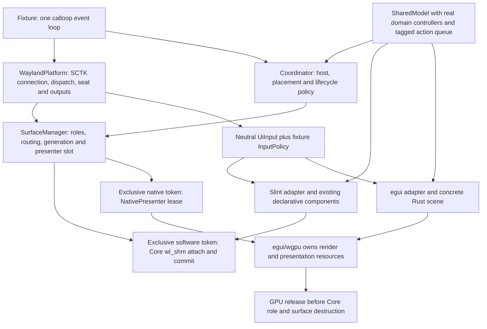

# Post-S6 renderer decision-readiness assessment

> **Curated publication copy.** Source: `6304979719f1388e6ff98d549224107d0d45f284`, `docs/bakeoffs/renderer/POST-S6-DECISION-READINESS.md`. Private paths/identifiers are redacted and links to omitted material lead to the [excluded-source catalogue](SOURCE-REFERENCES.md). Original source and hashes are listed in [provenance](provenance.json). This is a dated record: historical ADR statuses, approvals and test counts describe their original scope, not new acceptance. Current initial selection is [Accepted ADR-0006](../../ADR/0006-renderer-selection.md); Gate P remains NO-GO. References to the repository, its history, implementations or raw evidence describe the retained original experimental repository, not this curated branch. Commands are historical descriptions, not runnable reproduction instructions or execution authorization for this curated snapshot.

2026-11-05. Evidence and source baseline: signed `194c27e8b5278f0de178a9986aafef31da9d3b68`, branch `experiment/egui-wgpu-bakeoff`. [Maintainer scope][authorization]; [independent review][review]. Documentation and source inspection only. No candidate, compositor, collector, test suite, build or benchmark was executed for this consolidation. Prior test/replay counts below describe preserved evidence, not new verification.

## Readiness conclusion and authority

Both concrete adapters demonstrate compatibility with OwlenShell-owned SCTK native surfaces in the tested environments. The shared Core boundary is a viable basis for maintainer architecture discussion. Neither the S1–S6 fixture nor its tests establish a completed production migration, complete toolkit equivalence or a winning renderer.

- **Functional evidence:** scoped PASS records for both renderers, with overall coverage PARTIAL. Multi-output/lifecycle acceptance is SwayFX-specific; Niri multi-output remains BLOCKED.
- **Architecture:** native connection, output, layer-role, generation, placement and Coordinator policy can be retained with either tested presenter. The production entry is still Slint; fixture scheduling, shutdown and composition must not be described as deployed production behavior.
- **Comparative performance:** no decision-grade matched result. Historical static Gate R remains BLOCKED/NO-GO. All existing measurements remain permanently **EXPLORATORY — NON-DECISION-GRADE**.
- **Selection and production:** ADR-0006 stays Proposed and its decision remains deferred. Gate P has not passed. Maintainers own support requirements, trade-offs, renderer selection and any later integration approval. This report changes no gate or authorization. [S6][s6], [production entry][prod], [Gate R/P][gates], [ADR-0006][adr6], [ADR-0007][adr7].

The information is sufficient to discuss ownership and migration choices. It is not sufficient to claim production readiness, comparative superiority, complete visual equivalence or universal compositor compatibility. The current ADR explicitly defers selection until acceptance and matched benchmark evidence; choosing a different evidence requirement would itself require a maintainer decision, not an implicit waiver here.

## Evidence vocabulary

PASS means the named recorded contract passed at its tested revision/environment, not that every framework capability passed. PARTIAL means incomplete coverage. BLOCKED identifies an unmet precondition. UNVERIFIED means the required observation is absent. Historical FAIL and NO-GO are retained: FAIL is a test result, while NO-GO is a scoped gate decision. NOT APPLICABLE needs a rationale. No missing evidence is converted to a negative score, and assertion counts are not comparable scores.

Source-derived facts below are checked against the baseline implementation. Technical interpretations are labeled as such. Runtime findings are attributed to the linked historical run/provenance/review records. Composed screenshots, client submission, frame callbacks, GPU completion and physical display latency remain different kinds of evidence. [Definitions][gates], [recorded S6 audit][s6review].

## Consolidated S1–S6 evidence matrix

| Slice / contract | Slint recorded finding | Native egui recorded finding | Exact scope, provenance and remaining limits |
|---|---|---|---|
| S1 real Coordinator bar/clock/calendar | PASS scoped:25 click sequences, ten popup cycles,17 native lifetimes | PASS for the same declared controls;30 normalized domain/placement states match across the two runs | One scale1 nested Niri output. Actual domain controller types, deferred actions and UI incarnations. Build is **base `7b83576f…` plus exact source-hashed overlay**, not a clean-base binary. Binary `c878958f…`; [report][s1], [overlay/binary provenance][s1prov]. No pixel or whole-shell equivalence. |
| Original S2 no-focus-on-map assertion | PARTIAL;70PASS/1FAIL/2UNVERIFIED; historical full-contract NO-GO | Same recorded outcome | Pinned Niri focused the OnDemand calendar after the clock activation. Candidate exit0 did not make the supervisor's failed assertion pass. Runtime `3bf019c4…`; source/oracle provenance in [original S2][s2old]. This failure remains unchanged. |
| Adopted S2 User-Open Focus |87PASS/0FAIL/4UNVERIFIED |87PASS/0FAIL/4UNVERIFIED | Prospective maintainer contract permits focus on mapping after user activation. Niri grant is observed, not universally promised. Harness `588ed633…`, unchanged runtime `3bf019c4…`. Native repeat, zero-delta delivery, unsolicited/background mapping and immediate private-cache erasure remain UNVERIFIED. [Adoption and evidence][s2]. |
| S3 scheduling / functional idle |19PASS/0FAIL/3UNVERIFIED/1NOT APPLICABLE |23PASS/0FAIL/3UNVERIFIED, including foreign-thread repaint delivery/rejection | One scale1 Niri output: initial/final ten-second quiescent windows, five domain clock ticks, real renderer deadlines, navigation, resize and cancellation. Runtime `9b4c7d8f…`, execution oracle `a1c462bc…`, later offline-reader tightening `9b6f8f9f…` kept distinct. Different counts reflect different mechanisms. Functional quiescence is not CPU/GPU/energy efficiency or animation pacing. [S3][s3]. |
| S4A output-scale compatibility |211PASS/0FAIL/3UNVERIFIED in full-input series; separate visual41PASS/0FAIL/3UNVERIFIED |Same recorded counts; both functional and bounded visual contracts PASS | Scales1/1.25/1.5/1.75/2 and live transitions in nested Niri. Integer1/2 client buffers; fractional output downscaling by compositor. **Native fractional buffers/viewports remain unimplemented/UNVERIFIED.** Full-input source `d8186779…`, same-binary visual supplement harness `1e657fd9…`; original1439-row captures remain incomplete, not repaired. [S4A][s4]. |
| S5 independent output pairs |Slint03 supplemental scoped PASS |egui02 supplemental scoped PASS | Direct private headless SwayFX, two independently identified outputs, two bar/calendar pairs, mixed scales, placement changes and independent state/deadlines. Raw receipts remain PARTIAL pending external review; supplemental review supplies scoped PASS without rewriting them. Same Rust binary, Slint harness `5a3f41b8…` / corrected egui harness `94b2adf8…`. [S5][s5]. **Separate Niri capability gate remains BLOCKED** and ran no S5 renderer candidates. [Niri gate][niri]. |
| S6 output lifecycle / shutdown |7/7 declared scenarios PASS; overall PARTIAL |7/7 declared scenarios PASS; overall PARTIAL | Private SwayFX only: three A removal/rebirth cycles, B operation, zero-output interval and recovery; placement restart; direct SIGINT/SIGTERM; repeated requests; separate fault and SIGKILL controls. Five natural graceful exits per renderer before harness cleanup.46 ordered native lifetimes each, including one unbound egui init failure; fault/abrupt controls are not graceful cycles. Rust `fbcf761e…`; Slint driver `c8cc4131…`, egui callback-accounting correction `5be9f611…`; unchanged binary `1518f254…`. [S6][s6], [structured facts][s6facts], [acceptance/gaps][s6accept]. |

These are successive bounded experiments, not one frozen binary that has passed every slice together on every compositor. Source/binary/harness identities, exceptions and full SHA-256 values remain in the linked provenance. Later S2/S3 regression runs are explicitly recorded by S3/S4A; they are not inferred from this table. S6's134 Core,54 fixture and113 harness test passes are historical test-log evidence, not tests rerun by this review. [S3 regression][s3], [S4A regression][s4], [S6 tests and review][s6review].

### Cross-slice interpretation

- The S2 product-contract correction does not reinterpret the original FAIL. Layer-shell OnDemand focus policy and renderer input routing are separate. Private SwayFX S5/S6 did not establish keyboard capability, so Niri's single-output focus result cannot fill their multi-output focus gaps. [S2][s2], [S5][s5], [S6][s6].
- Niri S5 exposes one nested winit output despite two host outputs. The blocker is the inspected environment, not a demonstrated Slint or egui inability. SwayFX's two-output PASS is compositor-specific and never a substitute for Niri evidence. Registry removal/rebirth is synthetic lifecycle evidence, not physical DRM connector hotplug. [Niri][niri], [SwayFX capability][swaycap], [S6][s6].
- Captures establish bounded visible content and placement; fractional downsampling softness and rasterization differences remain. They do not authenticate per-glyph font fallback, actual alpha-buffer values, pixel-perfect equality or physical presentation latency. [S1][s1], [S4A][s4], [S6][s6].
- Actual scheduled old-generation egui Context repaint rejection is separately verified in S3/S6. It does not establish deliberately timed native-wire callback races, GPU-fence completion or device-loss recovery. The S6 raw UNVERIFIED callback receipt remains unchanged beside the narrower supplemental finding. [S3][s3], [S6 review][s6review].

## Proven ownership boundary and remaining coupling

The diagram describes the **experimental functional composition** at the baseline, not a new core crate or a deployed production structure. “Production entry” below means the repository's ordinary `src/main.rs` path in this experimental checkout, not the installed or running desktop. No migration has been deployed.

Only the selected presenter path executes for a token. Core owns policy/native lifetime in both paths; GPU presentation legitimately owns its buffer attachment/commit. `NativeFrameTarget` passes real Connection/LayerSurface handles. Exactly-one-submit, no reentry and synchronous idempotent release are explicit implementation contracts, not a type-level sandbox preventing arbitrary violations. Retain that distinction when assessing future adapters. [UI/presenter contracts][ui], [retirement][retire], [presentation gate][present], [S6 runtime ordering][s6].

| Assessment criterion | Slint implementation evidence | Native egui implementation evidence | Technical interpretation / limit |
|---|---|---|---|
| Native SCTK compatibility |Core software presenter and bridge reuse existing roles/output policy |Generation-bound native presenter on the same manager/connection; no wayapp |Both scoped paths are demonstrated. Surface ownership is not an eliminator between them in the tested scope. [Coordinator][coordinator], [contract][ui], [S1–S6][s6]. |
| Generation/lifecycle safety |Core invalidates route/token before cancellation and software/native destruction |Same fencing; wgpu resources release before native role/surface; old renderer wake rejected |Native token, logical host and UI incarnation are distinct. Existing same-registration native replacement retains valid intent; removed registration rejects old intent. Tested safety does not prove every race or driver completion. [Retire][retire], [model][model], [S6 fence][fence], [S6][s6]. |
| Input/focus |Adapter translates UiInput to Slint events; fixture wrapper applies shared calendar policy |Explicit RawInput translation, enter coordinates, pointer cancellation and tagged callback routing |Tab/Enter/Space/Escape/scroll behavior partly comes from shared application policy. This is not blanket toolkit text-entry, IME, accessibility or focus-navigation parity. [Input types][inputtypes], [shared policy][input], [Slint events][slintinput], [egui events][eguiinput], [S2][s2]. |
| State and independent panels |Real generated bar/calendar components wrapped with per-model IDs and one shared Slint platform/bridge |Per-host egui UI/presenter state with the same controller snapshots and action queue |Coordinator owns host/placement policy; real Clock/Calendar controller data reside in fixture SharedModel outside either renderer. Do not claim every widget/controller is already managed by production Coordinator. Two fixed pairs are not a generic module system or Gate P's three independently configured panels. [Model][model], [multi composition][multi], [wrappers][slintwrap], [S5][s5]. |
| Scheduling/idle |Process-global Slint timers advanced once for aggregate; cancellable per-host cue timers |Per-host repaint deadlines, generation/pass validation, recorded cross-thread delivery and calloop channel wakes |Fixture waits on earliest domain/toolkit deadline; required work settles in recorded windows. Global-timer lifetime and cross-thread GPU wakes have different maintenance needs. No comparative idle-efficiency result. [Slint timers][slinttimer], [egui scheduling][eguischedule], [fixture loop][loop], [S3][s3]. |
| Scaling/rendering quality |Existing software configure and integer buffer handling |Explicit logical/physical/PPP mapping, ROOT viewport and zero-radius fixture hit policy |Compatibility at five scales is demonstrated; native fractional support and equal font rasterization are not. Readability/alpha/locales must meet maintainer requirements rather than a presumed framework ranking. [S4A][s4], [egui translation][eguiinput]. |
| Backend/dependencies |Slint1.17.1 renderer-software; BGRA painting then Core shm copy |egui0.35.0/egui-wgpu0.35.0/wgpu29.0.4, Vulkan-only prototype; observed RADV/Bgra8Unorm |Software path needs no client GPU adapter selection in this implementation, while the compositor can still use a GPU. One observed GPU/driver and explicit format policy do not establish other backends/hardware. [Manifest][manifest], [software paint][paint], [shm copy][shm], [GPU initialization][gpu], [format correction][format]. |
| UI composition/extensibility |Fixture inherits actual `ui/bar.slint`/`calendar.slint`; existing declarative components retained |Concrete Rust layout/drawing/hit regions implement bar/calendar behavior |Slint reuse reduces the amount of existing UI that must be recreated. egui moves that UI maintenance into Rust scene/input code. Which style suits future modules is a maintainer trade-off, not measured productivity. [Slint wrapper][slintwrap], [egui scene][scene]. |
| Resource/integration complexity |Adapter registration/rollback, Slint window callbacks, process-global platform, software conversions and buffer copying |Raw-handle lifetime, adapter/device/format negotiation, GPU acquire/configure/present/release and repaint translation |Both require local integration code. Each GPU epoch currently creates its own instance/device/queue/context/renderer: a prototype choice, not an egui requirement or measured overhead. Conversely source-visible CPU copies do not prove the software path slower. [Bridge][bridge], [paint][paint], [GPU][gpu], [present][present]. |
| Packaging/build and maintenance |Root library and production entry still depend on Slint |Functional package includes Slint and egui unconditionally and depends on that root library |The experiment is isolated from the default production dependency graph, but it is not an egui-only package. No standalone footprint/build-time or dependency-maintenance ranking is established. Upstream versions here are pinned records, not claims about latest releases. [Root manifest][rootmanifest], [fixture manifest][manifest], [production entry][prod]. |
| Production migration effort |Retain components/bridge, then review transferring fixture composition, deadlines and shutdown into the actual entry |Retain shared Core policy, but wire real egui UI/state/input/presentation and deployment dependencies; remove Slint only under separate scope if desired |Neither path is a completed migration. Both require reviewing fixture controls versus production requirements, real widgets/configuration and regressions. No staffing/day estimates or automatic choice follow. [Production entry][prod], [fixture loop][loop], [S6 controls][fence], [historical migration sketch][sketch]. |

`SoftwareUiHost` still names a concrete software contract; `UiRuntime::native_presenter` is a narrow presentation exception. This is a tested seam for these adapters, not a fully toolkit-free root crate, arbitrary backend plugin API or proof that every framework can fit unchanged. The root entry creates RenderBridge/SlintShellUi and retains a periodic domain timer/bounded dispatch timeout. The S3 earliest-deadline loop, S6 signalfd/OutputFence and explicit shutdown fence are fixture composition, not production-entry integration. [Contracts][ui], [production entry][prod], [fixture loop][loop], [S6][s6].

## Defects, corrections and unresolved risks

Corrections below are properties of their named revisions; no historical failure is rewritten as passing. This is not a count of framework defects.

| Finding / owner | Established correction or current state | Decision implication and evidence |
|---|---|---|
| Pre-existing Slint calendar clipping, custom adapter |Inner MinimalSoftwareWindow's weak Window owner bypassed outer property/redraw callbacks, leaving preferred32×32 instead of320×320. Custom adapter owns Window via Rc::new_cyclic and SoftwareRenderer; no hardcoded layout-size fix. |Local platform integration can affect UI correctness independently of Slint layout source. The isolated fix predates S1; pristine/reference failed evidence remains. [Calendar closure][calendar]. |
| Historical wayapp pointer-enter translation |Pinned wayapp omitted initial position. Native egui path explicitly translates SCTK Enter coordinates; it bypasses rather than repairs archived wayapp. |No demonstrated egui-core incapability; do not transfer historical integration-library failure to the native adapter or erase it. [Historical reproduction][oldarch], [native input][eguiinput], [S2][s2]. |
| Shared S2 focus-contract mismatch |Maintainer adopted User-Open Focus prospectively; exact unrelated assertions retained |Compositor policy, product requirements and renderer event delivery must be distinguished. Background mapping and cross-compositor grant policy remain open. [Original S2][s2old], [adoption][s2]. |
| S4 egui outside-close activation |Default nearby-hit radius activated close despite correctly delivered native coordinates. Fixture uses zero radius after controlled tests. |A prototype UX policy, not a universal accessibility recommendation or scaling failure. Hit padding remains product-owned. [S4 failed attempts and controls][s4]. |
| SwayFX egui initialization failure |Prototype selected Rgba16Unorm without enabled required features. New deterministic advertised Bgra8Unorm/Rgba8Unorm selection validates render/blend capability and fails explicitly; no optional-feature enablement. |Client format negotiation failed before compositor import, so this was not demonstrated buffer-import rejection. GPU capability handling is real local maintenance work; other hardware remains unverified. Original NO-GO and new scoped PASS coexist. [Format triage][triage], [correction][format]. |
| S6 Core/UI lifecycle hardening |Route/token invalidation precedes release; stale FrameRendered/Closed checks; UI retirement/rematerialization, action fencing, signal path and Slint recreated-bar weak-reference correction |Shared policy is reusable but lifecycle proof required actual changes, not a drop-in frontend switch. Closed-before-global_remove in a different dispatch ordering remains a risk; tested Sway ordering is not universal. [Retirement source][retire], [S6][s6]. |
| S6 oracle/provenance defects |Nullable hidden host, valid retained UI on native return, UI-local indicators versus persistent Core data, and canceled Mesa callback reuse corrected with independent review |Four original runs stay FAILED/BLOCKED. Final acceptance requires genuine Core callback completion; queue-label attribution is pinned to the logger. Reconstructed parent commands are not contemporaneous receipts. These findings limit the evidence method, not renderer quality. [S6 failures/provenance][s6], [independent review][s6review]. |
| Duplicate native pointer leave in SwayFX |Raw duplication remains PARTIAL; cancellation effects are idempotent in tested scenarios |No suppression to obtain PASS; root server/device-removal cause remains unproven. Keyboard capability was not established. [S5][s5], [format prerequisite][format]. |

### Risk and uncertainty register

Classification: **D** affects the present decision process; **J** can affect both selection and production under maintainer requirements; **P** primarily concerns operational/integration proof rather than distinguishing renderers. This is an information-relevance distinction, not permission to defer acceptance: the adopted Gate P is required before proposing renderer selection or requesting production change, including obligations that may not differentiate the candidates. No P item is waived. This is an uncertainty register, not severity weights or scores.

| ID / class | Open question and current status | What could change the decision; evidence needed |
|---|---|---|
| R1 D |Support/UX envelope and trade-off priorities not settled by this report |Maintainers specify target compositors/hardware, first usable modules, focus/accessibility, acceptable fractional quality and required fallback/recovery. Missing requirements cannot be invented by the agent. [Milestone][milestone], [Gate P][gates]. |
| R2 D |No authorized matched performance result; static Gate R BLOCKED/NO-GO |If resource/startup/frame cost is a selection driver, a scoped Gate R record must resolve actual scene/workload/attribution and measurement limits before a separately authorized run. Historical exploratory data cannot decide it. ADR-0006 currently defers selection until acceptance and matched evidence. [Static readiness][readiness], [ADR-0006][adr6]. |
| R3 D |Production/fixture coupling and migration scope differ |Maintainers assess existing Slint component reuse versus new egui scene/presentation code and shared Core work. Fixture source does not prove a shipping adapter, live module system or measured maintenance cost. [Production entry][prod], [contracts][ui], [multi][multi]. |
| R4 J |Niri two-output environment BLOCKED; SwayFX keyboard-focused removal/restore UNVERIFIED |If Niri multi-monitor shell behavior is required, SwayFX results cannot close this gap. Establish genuine private Niri outputs first; stop if unavailable. Keyboard tests require actual native capability/focus. [Niri][niri], [S6 gaps][s6accept]. |
| R5 J |Native fractional buffers UNVERIFIED/unimplemented; font/alpha/locale quality incomplete |Can be decisive if current integer-buffer downsampling, text appearance or alpha behavior fails a product requirement. Establish explicit visual/input expectations; do not presume GPU rendering is sharper or equivalent. [S4A][s4], [Gate P visual requirements][gates]. |
| R6 J |GPU/backend coverage and device-loss/recovery UNVERIFIED outside tested path |Vulkan-only native egui on one recorded RADV device is a prototype constraint. Non-GPU operation, other drivers/backends and recovery matter only under the chosen support envelope; do not claim framework impossibility. Software Slint still depends on the compositor for final display. [GPU source][gpu], [S6][s6]. |
| R7 J |Native-wire timing races, exact expiry/shutdown interleavings and server/driver completion UNVERIFIED |Existing generation tests and delivered renderer wake rejection reduce specific risks; they do not prove every dispatch ordering or GPU fence. Unsupported controlled injections must stay UNVERIFIED, not be replaced with synthetic events. [S6 review][s6review]. |
| R8 J |Rich text/IME, clipboard, accessibility, broader focus/input/layer/input-region policy and arbitrary module composition not established |These may determine suitability if required. Bar/calendar shared InputPolicy is not evidence that an entire toolkit cannot or can support them. Shipping dependency/licensing constraints likewise need review before treating them as settled. [Input source][inputtypes], [shared policy][input], [Gate P][gates]. |
| R9 P |Actual production composition/configuration/session integration and supported-combination regression incomplete |Required Gate P evidence for an isolated evaluation candidate before proposing selection or requesting production change. Preserve Core domain/output/placement/persistence and separate renderer UI from fixture-only controls. [Production entry][prod], [fixture main][loop]. |
| R10 P/J |Sustained stability/resource growth, physical connector/device recovery, three independently configured panels and operational packaging not fully covered |Gate P remains required before selection proposal/production-change request. A strict reliability, distribution or panel requirement can move this into selection-critical scope. Two fixed pairs and synthetic output globals are not complete E8/E9/E11. [Gate P][gates], [S5][s5], [S6][s6]. |

This separates selection questions from delivery obligations without claiming that a requirement is production-only for every possible product. Missing observations are UNVERIFIED or BLOCKED, not negative framework scores.

## Performance evidence stays separate

**EXPLORATORY — NON-DECISION-GRADE.** Exactly one authorized six-session idle execution measured historical Slint and wayapp-egui five-card mocks, three sessions each with30-second warmup and120-second observation. It was not the native Core bar/calendar fixture. Independent CPU/RSS/PSS observations and variance remain in the original [run report][exploratory] and [post-run analysis][explanalysis]; they are not reproduced here as a ranking or comparable current-adapter cost table.

Confounders include different platform/runtime initialization and scenes not proven equivalent,10ms CPU tick resolution, sharing variation, productive-host activity, missing GPU/session totals and no observed repaint/presentation or full per-VMA allocation breakdown. Zero observed CPU ticks is not zero work; RSS−PSS does not identify private/shared-library cost. RADV warnings in the measured processes do not establish their selected adapter or a memory cause. Later metadata-only launches selected Vulkan/RADV9070XT for their own egui processes and reported Slint's configured software/shm path; those are **not retroactive adapter/font observations for the idle windows**. Effective per-glyph faces/fallback remain unresolved. [Exploratory analysis][explanalysis], [separate metadata][metadata].

Current functional egui S6 has its own Vulkan/RADV/Bgra8Unorm runtime evidence, and current Slint has actual wl_shm submissions. That does not transfer old CPU/memory measurements to these adapters. The combined functional package includes both dependency families, and per-epoch GPU setup is a prototype choice; neither alone establishes resource costs. No superiority, energy, FPS, input-to-photon or memory-attribution conclusion follows. ADR-0007's permanent classification and separate run authorization remain in force. [S6][s6], [manifest][manifest], [ADR-0007][adr7].

## Proposed next evidence gates, ordered by information value

This order prioritizes questions and prerequisites, not renderers. It is a proposal for maintainer review only. No gate below authorizes provisioning, implementation, execution or measurement; the existing R/P framework and benchmark guard are unchanged.

| Order / proposed gate | Smallest useful scope and question | Acceptance, stop point and authority |
|---|---|---|
| N0: maintainer requirement decision, no runtime |Choose the supported compositor/hardware and first usable module/input/visual envelope; identify which open risks could actually change renderer choice. Review the concrete migration options below. |Written requirements and acceptance scope, including whether native fractional rendering, non-GPU operation, accessibility and matched performance are mandatory. No invented priorities/weights. This avoids measuring an irrelevant question. |
| N1: target-compositor and focused-lifecycle proof, conditional |If Niri multi-output is required, first a separately approved **environment-only** capability gate for two independent private Niri outputs. If a suitable approved environment supplies real keyboard capability, one focused A-calendar removal/restoration with a pending deadline and live B pair is the smallest named S6 closure. |Observe registry/output identities and actual keyboard focus/input, cancellation, B independence, new generations, restored visibility and cleanup. Stop BLOCKED if two outputs/capability cannot be established. No production Niri reconfiguration, two-panels-on-one-output substitution or inference from SwayFX. |
| N2: requirement-driven visual/input sample |If appearance/scaling could change selection, use the existing capture/input paths on bar/calendar at one or two declared fractional scales, fixed font/text and two controlled backgrounds, with tolerances reviewed before capture. |Verify logical/configured/buffer geometry, clipping, readability, alpha composition and hit targets. RGB captures alone do not prove actual alpha-buffer values. Native fractional implementation requires a separate S4N scope; no silent conversion of S4A or static Gate R PASS. |
| N3: smallest representative capability or failure control, conditional |Choose **one** undecided requirement: a real next module/control (for example text entry if required), or a required adapter/driver/fallback condition. Inspect needed boundary changes before any implementation proposal. |Predeclare behavior and expected failure/recovery; reuse Core ownership and existing private harness. Do not add a generic plugin system, shared-device framework or arbitrary toolkit feature campaign. If native ownership/exclusivity cannot hold, stop for architecture review. |
| N4: Gate R eligibility record, required for the current ADR selection path |ADR-0006 currently requires matched benchmark evidence before selection. Maintainers choose exact candidate/binary/scene, environment and metrics; making comparisons optional would require a separate explicit maintainer decision about that requirement, not this review. Start with the smallest static scope that answers the maintainer's question; do not import historical five-card eligibility or exploratory results. |Reviewed connection/surface association, full declared scene and workload, measurement isolation/attribution, exclusions, cleanup and source bindings are mandatory. A new reviewed record may prospectively close a blocker for its exact scope; historical NO-GOs remain unchanged. Performance values cannot be entry thresholds. Explicit execution authorization is still needed after readiness. |
| N5: Gate P for an isolated production-shaped evaluation candidate |Under separate approval, evaluate a bounded candidate composition and complete supported E1–E11, session/configuration/module, physical/reliability/packaging requirements. This is an evaluation candidate, not a selected or deployed renderer. |Complete Gate P **before proposing renderer selection or requesting production change**, as adopted policy requires. Evaluation implementation/provisioning/real-system checks need their own approval; actual integration remains a later separate maintainer decision. If safe required evidence is unavailable, retain BLOCKED. Decision-discriminating requirements in this row may warrant earlier investigation under N0–N3. |

No follow-up is automatic. In particular, do not restart the private Niri lifecycle diagnostic, implement a Wayland proxy, rework the visual infrastructure or collect another exploratory memory snapshot merely to populate a comparison table.

## Maintainer-owned migration trade-offs

| Unranked path | Concrete reuse and remaining work | Trade-offs requiring judgment |
|---|---|---|
| Evaluate retaining Slint through a narrow boundary migration |Retain declarative bar/calendar and software bridge; review transfer of neutral routing, event-driven scheduling, state/incarnation handling and shutdown into real composition |Preserves existing UI assets and one software presenter. Still carries custom platform/window/timer integration and production regression work; existing use is not proof that deployment gaps are closed. [Slint wrapper][slintwrap], [production entry][prod], [S6][s6]. |
| Evaluate native egui integration behind the demonstrated seam |Retain Core SCTK/coordinator/output/placement/persistence; maintain concrete Rust UI/input and GPU presenter; define supported adapter/format/recovery and dependency packaging |Native ownership is feasible without wayapp. GPU resource and scene/layout maintenance are additional concrete responsibilities, while an egui-only shipping dependency graph remains unproven. No rewrite of Core is implied. [Native contract][ui], [egui source][scene], [GPU][gpu], [manifest][manifest]. |
| Keep both experimental adapters while resolving a decision-critical requirement |Use current reproducible fixtures and source evidence; implement no broad backend framework solely to retain optionality |Preserves a reference for challenging assumptions, but maintaining two UIs is work whose value depends on the unanswered product question. No hybrid production runtime or adoption is presumed. [Milestone][milestone], [S6][s6]. |

Maintainers must decide whether existing declarative UI reuse, desired Rust UI style, supported graphics stack, required controls, measured resource evidence and integration obligations favor a path. This report assigns no weights, overall scores or renderer ranking. GTK4, Qt6/QML and Iced received no S1–S6 execution and are not technically rejected by this two-renderer assessment. COSMIC/libcosmic remains WITHDRAWN — NOT FULLY EVALUATED. [Existing unranked matrix][comparison].

## Review, preservation and stop

The prior reports remain authoritative for their own sources, contracts and environments. Historical phrases such as “no PASS” in the initial acceptance inventory, “S2 NO-GO” and “Niri S5 BLOCKED” are not erased or repurposed. This dated synthesis is the current reading guide; original hashes, raw statuses, failed captures, execution receipts and independent findings remain untouched. No approved gate, benchmark guard, ADR status or source implementation changes here.

Documentation verification checks links/source anchors, the documentation-only diff and preservation of the baseline evidence/ADR files. It does not rerun historical audit executables, candidate tests or measurements. [Independent assessment review][review]. Stop after the signed documentation handoff and await a maintainer decision.

**Renderer selection remains a maintainer decision. No winner has been selected.**

[authorization]: SOURCE-REFERENCES.md#source-f9010ce1f05280e6
[review]: reviews/2026-11-05-post-s6-decision-readiness.md
[s1]: results/2026-11-04-s1-functional-parity/README.md
[s1prov]: SOURCE-REFERENCES.md#source-9351b4dc08beb6d0
[s2old]: SOURCE-REFERENCES.md#source-dc2f658b56f18a04
[s2]: results/2026-11-05-s2-user-open-focus/README.md
[s3]: results/2026-11-05-s3-scheduling/README.md
[s4]: results/2026-11-05-s4-scaling/README.md
[s5]: results/2026-11-05-s5-multi-output/README.md
[s6]: results/2026-11-05-s6-lifecycle/README.md
[s6facts]: SOURCE-REFERENCES.md#source-6e7b16093eb099a4
[s6accept]: SOURCE-REFERENCES.md#source-600a606df37323eb
[s6review]: reviews/2026-11-05-s6-lifecycle.md
[niri]: SOURCE-REFERENCES.md#source-152e70ea128027c3
[swaycap]: SOURCE-REFERENCES.md#source-40a26b7d69975bec
[gates]: GATE-PROPOSAL.md
[adr6]: ../../ADR/0006-renderer-selection.md
[adr7]: ../../ADR/0007-renderer-bakeoff-evidence-scope.md
[readiness]: SOURCE-REFERENCES.md#source-2140e71b8be7ba02
[exploratory]: SOURCE-REFERENCES.md#source-650d9c951033d2ac
[explanalysis]: SOURCE-REFERENCES.md#source-a41eff4735c296d2
[metadata]: SOURCE-REFERENCES.md#source-0c557c86ec82b100
[calendar]: SOURCE-REFERENCES.md#source-e7c0480d239b7289
[triage]: SOURCE-REFERENCES.md#source-94f72791f964d7ff
[format]: SOURCE-REFERENCES.md#source-590bbbadab5ec52e
[sketch]: SOURCE-REFERENCES.md#source-18b73e4bd312cf77
[oldarch]: SOURCE-REFERENCES.md#source-e965c84ec042341d
[milestone]: SOURCE-REFERENCES.md#source-36d36ba96d923d46
[comparison]: SOURCE-REFERENCES.md#source-d4a7fc96adaca83e
[prod]: SOURCE-REFERENCES.md#source-9c0846679bfdd261
[ui]: SOURCE-REFERENCES.md#source-e2a9690cc59100a9
[inputtypes]: SOURCE-REFERENCES.md#source-4af69d2c413c07b8
[coordinator]: SOURCE-REFERENCES.md#source-d6f54851323b5698
[retire]: SOURCE-REFERENCES.md#source-6c133ac715f74b1c
[present]: SOURCE-REFERENCES.md#source-7502b4258f689c6b
[shm]: SOURCE-REFERENCES.md#source-81cd532c3d0525f8
[paint]: SOURCE-REFERENCES.md#source-44baccb73b186f1d
[bridge]: SOURCE-REFERENCES.md#source-f6d9e7d77fd516bc
[slintinput]: SOURCE-REFERENCES.md#source-241c79985c415f65
[model]: SOURCE-REFERENCES.md#source-c94543c5bea071d1
[fence]: SOURCE-REFERENCES.md#source-a515c1fc5d94841d
[multi]: SOURCE-REFERENCES.md#source-55adb9ef8943b35c
[input]: SOURCE-REFERENCES.md#source-5f49334c6c0fd764
[slintwrap]: SOURCE-REFERENCES.md#source-829c5ac42f4f1d1a
[slinttimer]: SOURCE-REFERENCES.md#source-b6a9c8daae17cba7
[eguiinput]: SOURCE-REFERENCES.md#source-dfbc46c61cca3552
[eguischedule]: SOURCE-REFERENCES.md#source-d5917d13c4ab0f23
[scene]: SOURCE-REFERENCES.md#source-cfa784e912f82453
[gpu]: SOURCE-REFERENCES.md#source-38292def1aeaf55e
[loop]: SOURCE-REFERENCES.md#source-3baa510e925256e4
[manifest]: SOURCE-REFERENCES.md#source-fc34526216b9bd91
[rootmanifest]: SOURCE-REFERENCES.md#source-9846e8e61b9a020b
