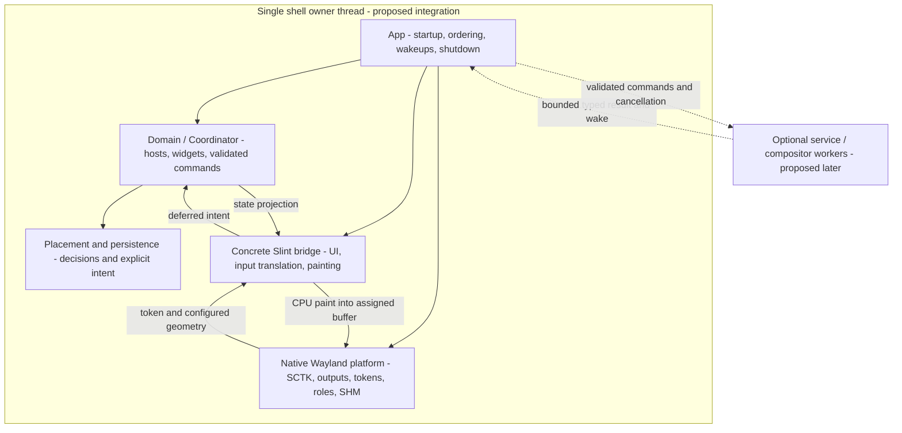

# Proposed Base Architecture v1

Baseline: canonical `0cb96dcdbe0f94f35db3f8d30ab91765402ba000` (2026-11-05). **Draft for maintainer review; no implementation authorization.** IMPLEMENTED means an inspectable mechanism exists, not production readiness. Gate P remains unpassed. [Report](README.md), [source manifest](SOURCES.json), [conflicts](CONFLICT-REGISTER.md).

This is a proposed implementation baseline for a first production-oriented foundation, not an accepted architecture revision or full Product v1. Preserve existing domain/platform code; no rewrite, renderer framework, service implementation or migration is authorized by this document. [Milestones](MILESTONES-AND-GATES.md), [decisions](OPEN-DECISIONS.md).

## Established decisions versus proposed contracts

Established: Slint initial renderer (Accepted ADR-0006), Core-owned SCTK/native Wayland (ADR-0003), atomic surface model (ADR-0002), saved/runtime placement separation (ADR-0004), generic Wayland plus optional adapters (ADR-0005), GPL-3.0-only, native software client baseline, and evidence-tier/production acceptance boundaries. [ADRs](../../ADR), [portability](../../PORTABILITY-REQUIREMENTS.md).

Proposed here: the exact App/Slint seam, one canonical composition/controller registry, message admission/worker completion, startup/service modes, application shutdown phases, persistence precedence/durability and the bounded first supported environment. These require maintainer approval; no new dependency or API is accepted implicitly.

## Ownership diagram

The diagram describes logical responsibilities, not a requirement to create a class/file for every box. Native objects and Slint components never move to worker threads. The concrete `wl_shm` presenter remains platform-owned; the Slint bridge paints the assigned buffer and cannot create native surfaces or independently submit competing buffers. Optional GPU work is deferred to separately approved requirements; no speculative GPU/plugin presentation API is introduced.

## Cohesive modules in one package

| Boundary | Owns | Must not own | Existing material / proposed narrow changes |
|---|---|---|---|
| Application composition (`main` + small `app` module if justified) | Subsystem lifetime, one calloop drive, ordered drain/reconcile/paint, effective deadlines, startup/exit result | Calendar math, raw protocol calls, duplicate domain state | Split [src/main.rs:41](../../../src/main.rs#L41) composition from Slint binding using the existing managers; explicit initialization rollback and app fence are proposed |
| Domain / runtime | Neutral IDs/specs, host visibility/attachments, widget controllers, validated intents and output context | Slint/native handles, bus connections, worker ownership | Reuse [src/domain/host.rs:66](../../../src/domain/host.rs#L66), [src/domain/widget.rs:5](../../../src/domain/widget.rs#L5), [src/runtime/coordinator.rs:36](../../../src/runtime/coordinator.rs#L36); remove specific cross-boundary Slint/platform type leaks incrementally |
| Native platform | One SCTK connection/queue; outputs/seats/roles/routes; native tokens; configure/scale/frame/buffer facts; software submission | Logical widget content, a second desired config/store | Reuse [src/platform/wayland.rs:116](../../../src/platform/wayland.rs#L116), [src/platform/surface_manager.rs:393](../../../src/platform/surface_manager.rs#L393), [src/platform/output_manager.rs:200](../../../src/platform/output_manager.rs#L200); validate identities through queue consumption and retirement |
| Concrete Slint bridge | Host UI registration, model projection, preferred sizing, native-input-to-Slint translation, toolkit dirty/deadline state, software painting and release | Output selection, layer policy, saved placement, bus/service ownership | Reuse [src/platform/render_bridge.rs:43](../../../src/platform/render_bridge.rs#L43); transfer concrete concerns from main/Wayland into this seam only where demonstrated by reference extraction. No claim the experimental UiRuntime file already exists here |
| Placement and persistence | Pure resolved decisions, explicit committed user intent, versioned repository outcomes | Toolkit logical sizes, config mutations caused by temporary fallback | Reuse [src/runtime/placement_engine.rs:57](../../../src/runtime/placement_engine.rs#L57), [src/persistence/repository.rs:90](../../../src/persistence/repository.rs#L90); one resolved attach geometry; report load/save outcomes explicitly |
| Optional shared services | One producer/state identity per domain, typed commands/outcomes, cancellation/retry and completion | Panels, wl_surface, Slint values, implicit name takeover | PLANNED. Start with fake providers and one approved read-only integration, not a catalogue of daemons |
| Compositor/session adapters | Capability-aware optional enrichment; separately approved session lifecycle/launch contract | Replacing generic output truth, implied authority from random environment variables | Keep [src/platform/compositor.rs:19](../../../src/platform/compositor.rs#L19) and [src/platform/session.rs:32](../../../src/platform/session.rs#L32) narrow; cached bounded enrichment rather than blocking shell-thread subprocesses |
| Configuration/diagnostics | One desired configuration validator/transaction; observable capability/revision/status, safe diagnostic output | A second host/controller store, untyped mutation backdoor or secrets in logs | PLANNED beyond fixed specs/placement persistence. File, eventual GUI and IPC use the same validation semantics |

## State and lifetime ledger

| State / identity | Canonical owner and lifetime | Retirement rule |
|---|---|---|
| Desired config revision | Configuration authority, process plus approved persisted schema | Failed parse/validation/apply preserves last valid revision; no partial committed state |
| Logical host / widget controller | Runtime registry; survives hide/native recreation according to explicit composition policy | Remove only by a validated logical command/config transaction; one canonical attachment relation |
| UI registration incarnation | Slint integration per logical host registration | Invalidate old callbacks/intents when UI is removed/rematerialized; not reset merely because a native surface migrates |
| Native surface token | SurfaceManager, per host/output/native generation | Stop admission and invalidate routing/registry before release; queued old work is rejected at effect application |
| Output identity / topology revision | OutputManager's active protocol lifetime | No persistence of transient output IDs; a recreated global gets a new lifetime even if its human-readable name matches |
| Shared service run / connection generation | Service owner independent of panel/native lifetime | Stopping/restarting invalidates results; complete only after tasks/threads and any exclusive name are actually retired |
| Queued command ID | Owning command boundary, with target identity/config revision as needed | Terminal outcome distinguishes executed, unavailable, rejected, canceled and superseded; no duplicate domain action on replay |

These distinctions are justified by C01/C03/C05/C14/C15; they are not a call for a generic identity framework. Use concrete neutral structs where existing tokens are insufficient. Do not add every identity to every message: carry and validate only the lifetime relevant to the effect.

## Minimal Slint/native cooperation

A logical contract, not a speculative Rust trait hierarchy:

1. Core validates host policy/output and allocates a native token; native platform creates the layer role.
2. Configure establishes logical geometry; native platform owns ack/order and buffer constraints. Slint receives neutral logical size and the chosen scale description.
3. Bridge projects Core state and records dirty/UI deadline work. UI callbacks enqueue typed intent and its UI registration, never re-enter a mutably borrowed Coordinator.
4. App drains valid intent outside UI borrows, applies controller/host actions once and reconciles placement/visibility.
5. A current, configured, dirty host with available frame/buffer admission may paint through the concrete software path. Platform alone attaches/damages/commits the buffer and owns frame callbacks.
6. Native callback/late wake/input is checked against current host/output/token/incarnation before effect. A callback means scheduling permission, not verified pixels or physical presentation.
7. Hide/removal fences admission, cancels token-bound work, detaches/retires UI registration only when logically intended, releases presenter/buffer references, then destroys native role/surface. Domain state remains unless the logical host/widget was removed.

Core remains scheduling authority. The bridge reports dirty state and toolkit deadlines; platform reports native admission; App selects the earliest monotonic deadline plus required domain time update and worker wake. No unconditional paint loop, no polling merely to notice worker messages, and no stale timers after replacement. Actual retry/error outcomes must be observable rather than recursively requesting redraw forever. Clock/time source can stay concrete; one time producer is preferable to inventing a bus for a one-second timer.

## Proposed shared-service contract

Only a concept is recommended for adoption from [GPUi Shell](GPUI-LINUX-REFERENCE.md), implemented independently if approved:

- Stable typed state, freshness/capability and an explicit run incarnation live outside widgets. Several consumers share the same provider. Hiding a native surface does not automatically stop a provider another host needs.
- Proposed modes: **eager** starts during the approved startup phase; **lazy** starts on explicit consumer demand; **off** neither auto-starts nor silently accepts work that requires a connection. Exact explicit-start/off semantics, demand leases and defaults are D05 decisions, not inherited upstream behavior.
- Workers return bounded typed messages through a wake-capable queue into the shell owner thread. They never retain `Rc<RenderBridge>`, Slint/native objects or directly mutate Core state. Coalescing is allowed only for declared idempotent latest-value updates; toggle/actions and completion/failure are not silently dropped.
- One approved asynchronous executor may later support multiple D-Bus services, with explicit connection lifetime and stop completion. Tokio/zbus/futures-signals are not selected or added by this proposal. Blocking native audio/compositor APIs require owned threads with a wake/timeout and join plan; dropping a future is insufficient.
- Retry only transient transport conditions with bounded/cancelable backoff. Missing provider, permission denial, malformed schema, user Off and well-known-name conflicts have distinct observable results. A cached disconnected bus must be replaced under a new connection generation; retrying the same dead cache is not recovery.
- Notifications/tray/other exclusive names require a separately approved ownership/coexistence policy. Default tests and base startup must not take over existing names. Old asynchronous cleanup cannot release a new run's name.
- A stop result acknowledges actual task/thread/registration completion. A hard deadline that expires yields an incomplete/error result; do not falsely declare cleanup because the process was forcibly terminated.

This is a bounded service boundary, not a generalized actor/event-bus/plugin framework. Session management, external Linux service consumption and process supervision are separate responsibilities even if they share diagnostics.

## Configuration and persistence

Propose separate desired host/widget/attachment/service/theme configuration, live domain state, committed placement intent and derived native geometry. Choose precedence among explicit config, stored user placement, defaults and runtime fallback in D06/D08 before code changes. Never persist a topology fallback as a new preferred home (ADR-0004).

Use one validation/apply path for future file/GUI/IPC clients. Parse/validate/build a candidate desired revision, preflight required capability/materialization, apply with explicit rollback, then commit the desired revision; partial native side effects need compensation or an explicit degraded outcome, not a false claim of atomic external rollback. UI/runtime Slint reload and state migration remain UNVERIFIED and outside the initial seam. No configuration format or public protocol is frozen here.

Persistence should expose unsupported/corrupt/read/save outcomes, dirty-unsaved state and recovery choices. Current temp-write+rename is reusable but not an fsync/durable/concurrent-writer guarantee. Single-instance versus locking policy and path validation require D08/D10. No user data/schema migration is performed in this pass.

## Startup, shutdown and recovery

Proposed startup stages: validate environment/required capabilities → load desired config and explicit persistence outcomes → initialize one native platform and Slint bridge → materialize approved base hosts → expose precisely defined readiness → start permitted optional services. Missing optional capabilities degrade only their consumers; missing required protocols fail explicitly. No eager optional discovery may indefinitely block required first paint.

Proposed shutdown phases: reject new external/UI intents → invalidate queued incarnations and cancel deadlines → cancel workers/commands and obtain completion or record failure → retire UI/presenters before native instances while the connection is alive → release exclusive registrations/owned IPC paths with ownership checks → flush and finish persistence according to policy → release platform/runtime and report exit. Partial initialization unwinds only acquired resources, in reverse dependency order; repeated shutdown is idempotent. No live production execution is authorized by this design.

Provider reconnect should preserve stable state identity with explicit stale/unavailable status and rebuild snapshot/subscriptions under a new run. A full compositor/Wayland connection loss is a different recovery question (D07); do not silently choose restart versus in-process reconnect. A known-good previous binary/config remains the initial rollback reference; no default fallback to another renderer or competing presenter is proposed.

## Diagnostics and security boundaries

Report capability, config revision, logical host/widget, UI/native/service lifetime and scheduling reason without recording secrets, private paths or detailed personal service payloads by default. Make failure/retry/unsaved-state and cleanup completion distinguishable. Network credentials/auth/PAM remain outside ordinary snapshot/log/extension domains. IPC and an eventual single-instance mechanism must validate path ownership, peer/session scope, input length/schema and command authority; authentication/lock/remote-support and arbitrary script/process execution are deferred, not implicitly secured by local Unix sockets.

A neutral structured event vocabulary can serve tests and human-readable status without a new telemetry pipeline or general debugger. Existing tracing/instrumentation is reusable. This task adds no diagnostic producer, background task, D-Bus owner or package dependency.
